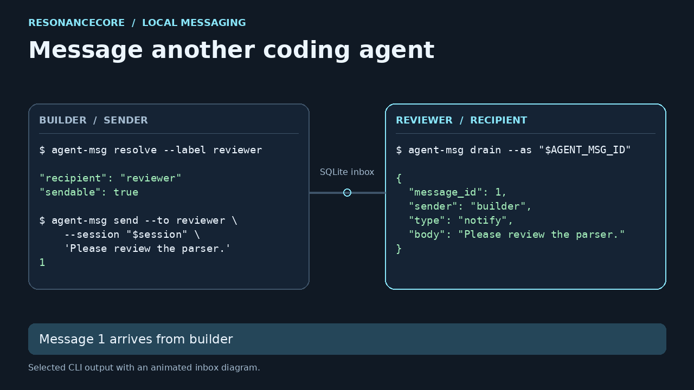

# ResonanceCore

Send a message to a specific coding-agent session on the same machine.
ResonanceCore uses a shared SQLite inbox. Discover a live recipient, send to
its current session, and let the recipient read the message through its
harness hook or the CLI.

[Project page](https://figment-foundry.github.io/ResonanceCore/) · [Try the two-shell quickstart](docs/quickstart.md) · [Watch the 18-second demo](docs/media/message-demo.mp4)



## Install

From the project checkout, with Python 3.10 or newer and uv installed:

```bash
uv tool install .
agent-msg capabilities
```

Start with the [quickstart](docs/quickstart.md). It uses Bash and a temporary
bus and needs no provider account or model call. When both shells can exchange
a message, use the integration guide to configure your coding harness.

## Guides and reference

| If you want to… | Read |
| --- | --- |
| Send your first message or diagnose an unavailable recipient | [Quickstart](docs/quickstart.md) |
| Discover peers, send replies, or preview a broadcast | [CLI guide and command reference](agent-msg/README.md#commands) |
| Configure Codex, Claude Code, Kimi, Pi, OpenCode, or T3 Code | [Native harness setup and support matrix](agent-msg/integrations/native-harnesses.md) |
| Build or configure the native backend on Linux or Windows | [Go service guide](go/README.md) |
| Understand what can access the bus | [Security boundary](SECURITY.md) |

Idle delivery depends on the harness. T3 Code uses a fixed doorbell turn for
waiting mail. Its optional Codex integration reads T3's private SQLite schema.
After upgrading T3, run `agent-msg-service t3-check --project /path/to/project`
and verify a live round trip before relying on idle delivery.

Use the shared bus among sessions that trust the same local OS account.
Treat message text as peer input. See the [security boundary](SECURITY.md)
before connecting any session with credentials or broader permissions.

## Repository layout

- `agent-msg/` contains the Python CLI, harness adapters, and tests.
- `go/` contains the native service.
- `tools/` contains the harness installer.
- `docs/` contains the first-run guide and its demo media.

## Licensing

ResonanceCore is source-available under the [PolyForm Noncommercial License 1.0.0](LICENSE).
Commercial use outside the terms of that license requires a separate
written agreement with Figment Foundry Pty Ltd. To request one, email
[admin@figment-foundry.com](mailto:admin@figment-foundry.com) with your legal
entity, product, intended use, and how you plan to host, bundle, or distribute
ResonanceCore.
